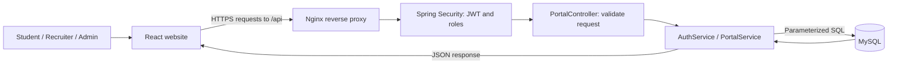
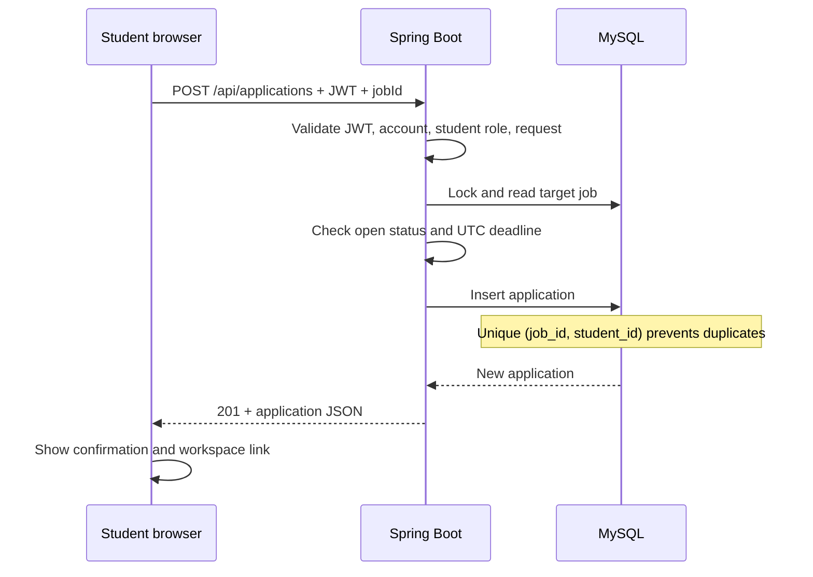

# How the Campus Placement Portal works

This guide follows the actual implementation. The interface is branded **campus.**; the project is still Campus Placement Portal.

## 1. The three parts

- **React + TypeScript** renders the pages, forms, filters, tables, and profile preview. React Router changes pages without downloading a new HTML document each time.
- **Spring Boot + Java** is the backend. It verifies identity and permissions, validates inputs, runs business rules, and reads/writes data.
- **MySQL** is persistent storage. Refreshing or restarting the application does not remove saved data.
- **Nginx** serves the compiled frontend in Docker and forwards `/api` requests to Spring Boot. In local development, Vite serves the frontend and Axios calls the backend directly.

A button in React is only the start of an operation. Spring Boot decides whether the operation is allowed. Hiding an admin button alone would not secure the API.

## 2. Accounts, passwords, and sessions

### Registration

1. A visitor chooses **student** or **recruiter** and enters their name, email, and password.
2. React sends `POST /api/auth/register`.
3. Bean Validation checks the request. Public admin registration is rejected.
4. `AuthService` checks email uniqueness and hashes the password with BCrypt.
5. MySQL stores `password_hash`; the original password is not stored.
6. The API returns a safe user object plus a signed JWT. Password hashes are excluded from API user responses.

Passwords must have 8–72 characters and fit within BCrypt’s 72-byte UTF-8 limit. Non-ASCII characters can use more than one byte.

### Login

`POST /api/auth/login` looks up the email and checks the submitted password against the BCrypt hash. A correct match creates a JWT containing the user id, role, name, email, issue time, and expiry.

A JWT is a signed credential, not an encrypted password. The server checks its signature and expiry before using it. The server also checks that the account still exists and its role still matches; deleting an account makes its tokens unusable on subsequent requests.

The default session lifetime is one hour (`JWT_TTL=PT1H`). The frontend keeps its token in `sessionStorage`, so it survives a refresh in the same tab but is not intentionally persisted across closed browser tabs. Browsers may restore tab sessions; always sign out on shared devices. Opening a tab from another tab can copy its session storage initially, depending on the browser.

Axios attaches `Authorization: Bearer <token>` to requests. On a rejected token, the client clears the session. A timer also clears it when the JWT expires. Logout clears the browser token; it does not centrally revoke a stolen copy of the token.

Browser storage is accessible to JavaScript. The Nginx content security policy reduces some script risks, but it is not a substitute for a full XSS review. For higher assurance deployments, consider a server-managed session or an HttpOnly cookie design with appropriate CSRF protection.

## 3. What a student does

1. **Create an account.** Sign in and enter the student workspace.
2. **Build a profile.** Save department, graduation year, CGPA (0–10), skills, phone, bio, and a resume URL.
3. **Review the preview.** It shows saved profile values. Initials are used when there is no profile photo.
4. **Explore opportunities.** Search titles, company names, descriptions, and eligibility text; filter by job type and location; sort by date/deadline.
5. **Apply.** Open a job, review its description and eligibility, and submit an optional cover letter.
6. **Track progress.** The workspace shows application statuses set by the recruiter.

`PUT /api/profile` creates a profile if one does not exist, otherwise updates the existing one. A unique `user_id` constraint prevents multiple profiles for one account. Blank optional number inputs stay unset; a valid CGPA of zero is preserved.

The profile progress indicator counts six saved fields: department, graduation year, CGPA, skills, resume URL, and bio. It is a UI aid, not an eligibility score.

The resume is a link, not a file upload. HTTP/HTTPS links are validated. Ensure the document’s sharing settings allow the intended reader to access it.

Search, filters, and six-card result pages currently run in the browser after fetching jobs. This is suitable for a small portal; move filtering/pagination into SQL before supporting a large catalog.

## 4. What happens when Apply is clicked

Closed or expired roles return `400`. Missing jobs return `404`. Duplicate applications return `409`. A deadline remains valid throughout its stated UTC date.

Academic eligibility is descriptive text. The system does not automatically compare a student’s CGPA/department with requirements, and applying does not guarantee an interview or offer.

## 5. What a recruiter does

The recruiter workspace calls `GET /api/jobs/mine`, not the public all-jobs list. It displays only jobs owned by the signed-in recruiter.

When a recruiter publishes their first job, the backend creates their company record. Later posts reuse it. Editing a company name changes the shared company name on all of its roles.

Job changes use `POST /api/jobs`, `PUT /api/jobs/{id}`, and `DELETE /api/jobs/{id}`. The backend checks job ownership independently of the interface.

`GET /api/applications` returns applicants only for that recruiter’s jobs, including academic information and cover letters. The recruiter can set `applied`, `shortlisted`, `rejected`, or `selected` using `PATCH /api/applications/{id}/status`. Ownership is checked before updating. Students see the new status when they refresh their workspace; there is no email, push notification, or live socket delivery.

The statuses are recruiter decisions, not an automated selection algorithm. The current workflow allows changing between any of the four statuses.

## 6. What an administrator does

Administrators are created privately. For a fresh deployment, use the explicit `bootstrap-admin` profile described in [DEPLOYMENT.md](DEPLOYMENT.md). The bootstrap refuses to run if an admin already exists and never logs the supplied password.

An admin can list users and delete users or jobs. Self-deletion is rejected by both the UI and backend. Destructive actions show a confirmation before submission.

Foreign keys cascade deletions. Deleting a student also deletes their profile and applications. Deleting a recruiter deletes their companies, jobs, and associated applications. Deleting a job deletes its applications. These actions are permanent; operational backups are essential.

## 7. Real data versus placeholders

| Content                       | Source                              | Saved to MySQL?                |
| ----------------------------- | ----------------------------------- | ------------------------------ |
| Homepage demo profiles        | `frontend/src/data/placeholders.ts` | No                             |
| Homepage sample reviews       | Same placeholder file               | No                             |
| Hero profile/progress preview | Clearly labeled illustrative UI     | No                             |
| Initials avatar               | Derived from a displayed name       | No uploaded image              |
| Profile field example text    | HTML `placeholder` attributes       | No; never submitted as a value |
| Student profile               | `/api/profile`                      | Yes, when saved                |
| Job board and dashboards      | Spring Boot API                     | Yes                            |
| Demo login accounts           | Explicit local seed script          | Only when you import seeds     |

The sample people and review copy are fictional presentation content, not member accounts, verified endorsements, or user-submitted reviews. There is no review-submission API, moderation workflow, rating calculation, or photo-upload service. Replace placeholders with approved content before presenting them as real community stories.

## 8. Where to find the code

| Concern                                  | Files                                                       |
| ---------------------------------------- | ----------------------------------------------------------- |
| Application routes                       | `frontend/src/App.tsx`                                      |
| Login state, token expiry                | `frontend/src/context/AuthContext.tsx`                      |
| API timeout, bearer header, 401 handling | `frontend/src/services/api.ts`                              |
| Public landing page                      | `frontend/src/pages/Home.tsx`                               |
| Demo profiles/reviews                    | `frontend/src/data/placeholders.ts`                         |
| Styles, components                       | `frontend/src/styles/index.css`, `frontend/src/components/` |
| REST endpoints                           | `backend/.../PortalController.java`                         |
| JWT, permissions, CORS                   | `backend/.../SecurityConfig.java`                           |
| Passwords, JWT creation                  | `backend/.../AuthService.java`                              |
| SQL and transactions                     | `backend/.../PortalService.java`                            |
| Input validation                         | `backend/.../Requests.java`                                 |
| Controlled admin creation                | `backend/.../AdminBootstrap.java`                           |
| Schema changes                           | `backend/src/main/resources/db/migration/`                  |
| API/security tests                       | `backend/src/test/java/.../PortalIntegrationTest.java`      |
| Migration tests                          | `backend/src/test/java/.../MigrationIntegrationTest.java`   |

The Java source package root abbreviated above is `src/main/java/com/campusplacement/portal`.

## 9. Error handling and reliability

Forms show server error messages, prevent duplicate submission while saving, and retain your input when a request fails. Data pages have loading, empty, and error states. Axios times out after 15 seconds.

API success responses contain `{success, message, data}`. Errors contain `{success:false, message}`. Unexpected internal errors are logged on the server and return a generic message instead of a stack trace.

Transactions keep multi-step writes together. Parameterized SQL separates user values from SQL text. Unique constraints protect data even if simultaneous requests reach the backend.

Flyway tracks applied schema migrations and applies new ones at startup. The application does not run the destructive demo schema script. The readiness health probe includes a database check; the simple `/api/health` endpoint only reports that the API handler is responding.

## 10. Production scope

The repository now includes a professional UI and a stronger deployment foundation: restricted admin registration, ownership enforcement, validation, migration tracking, health probes, required production secrets, a dedicated database account, and build checks in GitHub Actions.

A public launch still needs your infrastructure configuration and operational review: HTTPS termination, real secrets, database backups and restore tests, monitoring, privacy/retention rules, and a real MySQL staging run. Email verification/password reset, centralized rate limiting, server-side catalog pagination, token revocation, and recruiter verification are not implemented. Recruiters can still self-register and are not automatically verified employers.

Nginx limits login/signup requests when traffic goes through Nginx. Multiple proxies or a load balancer require a deliberately configured trusted-client-IP policy; do not blindly trust inbound forwarding headers.
